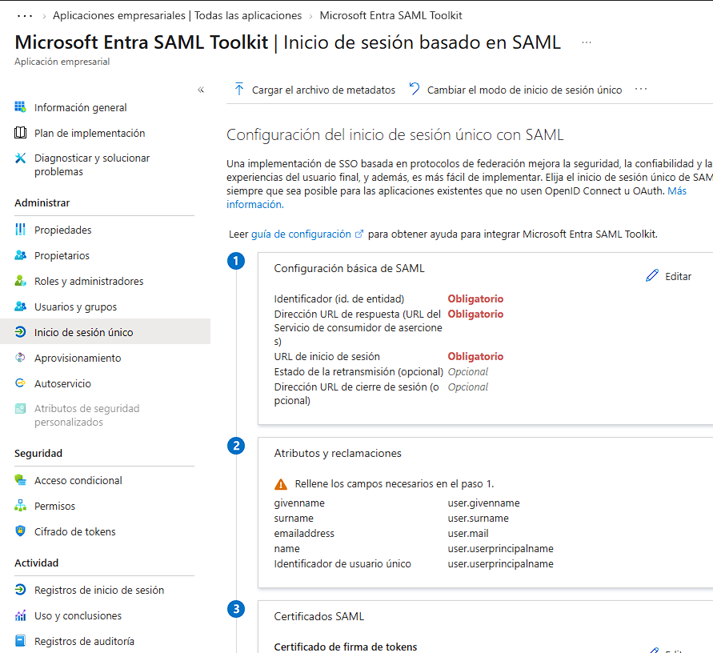
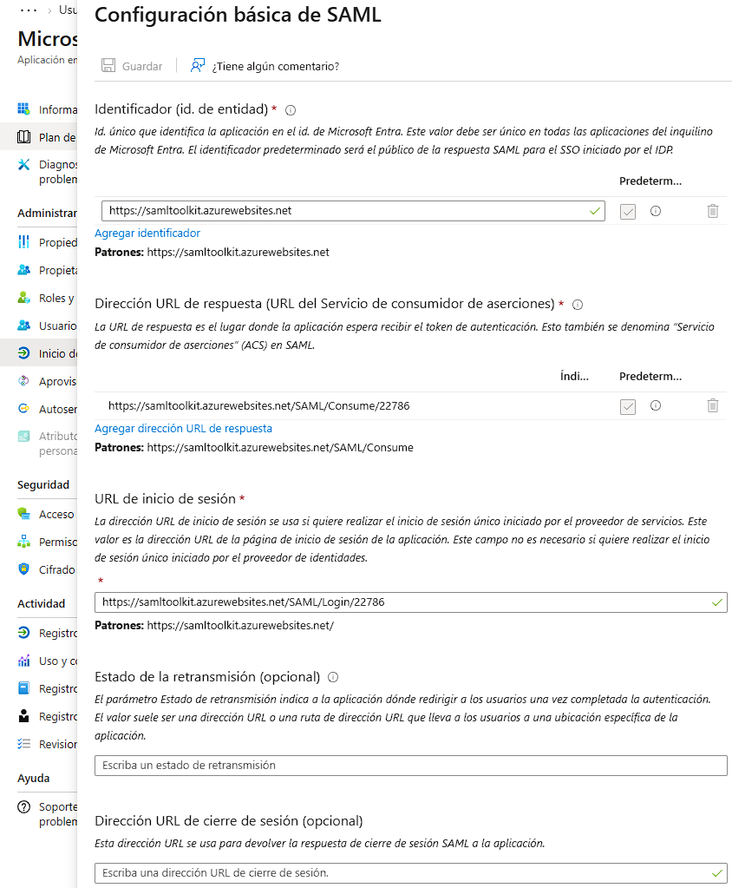
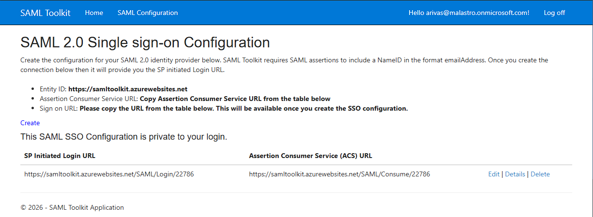
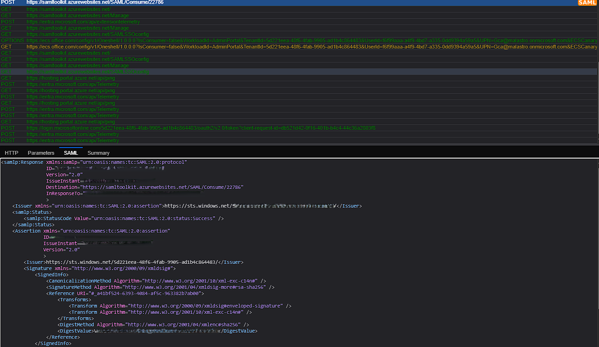
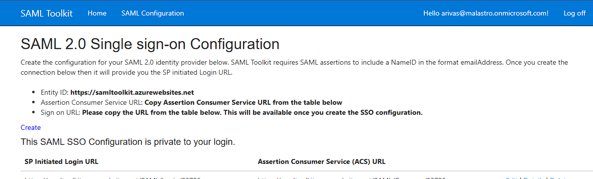

# Lab 04: SAML SSO con Microsoft Entra ID — Operación Amador Rivas

## 1. Descripción del proyecto

En Mirador de Montepinar, la seguridad de las identidades empieza a ponerse seria. Después de trabajar la identidad híbrida, la autenticación multifactor y la gestión del ciclo de vida de los usuarios, toca resolver otro problema: que los vecinos puedan acceder a las aplicaciones corporativas mediante un sistema de inicio de sesión único, sin tener que introducir sus credenciales en cada servicio.

En este laboratorio, **Amador Rivas (`arivas`)** será la identidad de prueba utilizada para configurar y validar el inicio de sesión único (*Single Sign-On*, SSO) mediante SAML 2.0.

La práctica utiliza Microsoft Entra ID como proveedor de identidad (*Identity Provider*, IdP) y Microsoft Entra SAML Toolkit como aplicación de prueba (*Service Provider*, SP).

El objetivo es configurar la confianza entre ambas partes, definir los atributos de identidad intercambiados y comprobar el flujo de autenticación mediante una prueba real y el análisis de las peticiones con SAML-tracer.

### Objetivos técnicos

- Configurar una aplicación empresarial en Microsoft Entra ID.
- Establecer los parámetros SAML entre el proveedor de identidad y el proveedor de servicios.
- Configurar Entity ID, ACS URL y Sign-on URL.
- Definir NameID y los atributos de usuario de Amador Rivas.
- Ejecutar el flujo SSO con Microsoft Entra ID.
- Analizar la respuesta SAML y verificar el acceso a una sesión autenticada.
- Documentar las evidencias y las consideraciones de seguridad.

**Escenario ficticio:** Mirador de Montepinar SL, donde Amador Rivas necesita demostrar que puede entrar al sistema sin tener que dar explicaciones cada vez que cambia de puerta.

## 2. Arquitectura del laboratorio

| Componente | Función |
|---|---|
| Microsoft Entra ID | Proveedor de identidad (IdP) |
| Microsoft Entra SAML Toolkit | Aplicación de prueba y proveedor de servicios (SP) |
| Amador Rivas (`arivas`) | Identidad utilizada para validar el acceso |
| SAML 2.0 | Protocolo de federación y autenticación |
| SAML-tracer | Inspección de las peticiones y respuestas del flujo |

### Flujo de autenticación

1. Amador inicia el proceso de acceso desde el Toolkit.
2. La aplicación redirige el navegador a Microsoft Entra ID.
3. Microsoft autentica a Amador y genera una respuesta SAML.
4. El navegador envía la respuesta al endpoint ACS del Toolkit.
5. La aplicación procesa la respuesta y establece una sesión autenticada.
6. Amador puede navegar por la aplicación sin volver a introducir las credenciales propias del Toolkit.

## 3. Configuración e implementación

### Fase 1. Preparación de la aplicación empresarial

Se utilizó la aplicación empresarial **Microsoft Entra SAML Toolkit** en Microsoft Entra ID y se asignó la identidad de prueba de Amador Rivas (`arivas`).

### Fase 2. Configuración básica de SAML

Se configuraron los endpoints y el identificador de la aplicación según los valores proporcionados por el Toolkit.

- **Identifier (Entity ID):** `https://samltoolkit.azurewebsites.net`
- **Reply URL (ACS):** `https://samltoolkit.azurewebsites.net/SAML/Consume/22786`
- **Sign-on URL:** `https://samltoolkit.azurewebsites.net/SAML/Login/22786`

Estos parámetros permiten identificar al proveedor de servicios, establecer el destino de la respuesta SAML y definir el punto de inicio del proceso de autenticación.

### Fase 3. Configuración de NameID y atributos

Se configuró el NameID con formato de dirección de correo electrónico y se utilizó `user.userprincipalname` como atributo de origen.

También se definieron las siguientes asignaciones:

| Atributo de salida | Atributo de origen |
|---|---|
| `emailaddress` | `user.mail` |
| `givenname` | `user.givenname` |
| `name` | `user.userprincipalname` |
| `surname` | `user.surname` |

Como parte de la preparación de la identidad de prueba, se completó el atributo `mail` de Amador para que coincidiera con la dirección utilizada en el Toolkit.

**Evidencia:** `screenshots/03-user-attributes-claims.png`

### Fase 4. Configuración del proveedor de identidad

Se configuraron en el Toolkit los datos de Microsoft Entra ID necesarios para establecer la confianza con el proveedor de identidad:

- URL de inicio de sesión de Entra ID.
- Identificador de Microsoft Entra ID.
- URL de cierre de sesión.
- Certificado de firma descargado desde Entra ID.

Los valores se guardaron en la configuración de la conexión utilizada para el laboratorio.

### Fase 5. Prueba de autenticación SSO

Se inició una prueba real con la identidad de Amador Rivas. Microsoft Entra ID solicitó la autenticación y, tras completarla, el navegador regresó al Toolkit.

Mediante SAML-tracer se identificó el envío de la respuesta al endpoint ACS:

`POST https://samltoolkit.azurewebsites.net/SAML/Consume/22786`

La respuesta SAML inspeccionada incluía el destino ACS configurado y un código de estado `Success`.

### Fase 6. Validación de la sesión autenticada

Tras completar el inicio de sesión con Microsoft, el Toolkit mostró `Hello arivas` y permitió navegar por sus páginas sin volver a introducir las credenciales propias de la aplicación.

Esta comprobación, junto con la traza del envío al ACS, aporta evidencia funcional del flujo SSO configurado.

## 4. Resultados

El laboratorio permitió configurar y probar un escenario de SSO federado con SAML 2.0 utilizando Microsoft Entra ID.

Se verificaron los siguientes resultados:

- Configuración de los endpoints SAML de la aplicación.
- Configuración del proveedor de identidad y del certificado de firma.
- Definición de NameID y atributos de usuario.
- Ejecución del flujo de autenticación con la identidad de Amador Rivas.
- Observación de la respuesta SAML enviada al endpoint ACS.
- Acceso a una sesión autenticada en el Toolkit.

La prueba funcional fue satisfactoria. No se realizó una auditoría independiente de todos los controles internos de validación de la aserción ni una comprobación exhaustiva de cada atributo recibido por la aplicación.

## 5. Consideraciones de seguridad

- El proveedor de servicios debe validar correctamente la firma y los elementos relevantes de la aserción SAML.
- Entity ID, ACS, emisor y destinatario deben coincidir con los valores esperados por la configuración.
- NameID y los atributos deben limitarse a la información necesaria para la aplicación.
- En producción deben revisarse los tiempos de validez y las medidas de protección frente a la reutilización de aserciones.
- Las respuestas SAML pueden contener datos de identidad y material sensible; no deben publicarse completas en repositorios públicos.
- Las capturas deben redactarse para ocultar identificadores innecesarios, datos personales y valores de autenticación.

## 6. Herramientas y tecnologías

- Microsoft Entra ID
- Microsoft Entra SAML Toolkit
- SAML 2.0
- SAML-tracer
- Enterprise Applications
- SSO y federación de identidades

## 7. Conclusión

Amador Rivas ha conseguido acceder al Toolkit mediante el flujo de autenticación con Microsoft Entra ID, sin tener que introducir de nuevo las credenciales propias de la aplicación.

El laboratorio permitió practicar la configuración de SSO con SAML 2.0, comprender la interacción entre un proveedor de identidad y un proveedor de servicios y analizar la respuesta enviada al endpoint ACS.

Esta práctica amplía los laboratorios de Mirador de Montepinar dedicados a identidad híbrida, MFA y gestión del ciclo de vida, reforzando las competencias fundamentales para un perfil inicial de Identity and Access Management (IAM).
